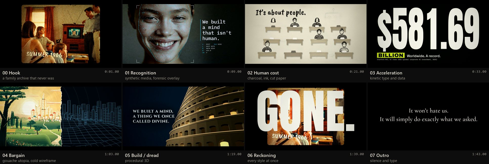
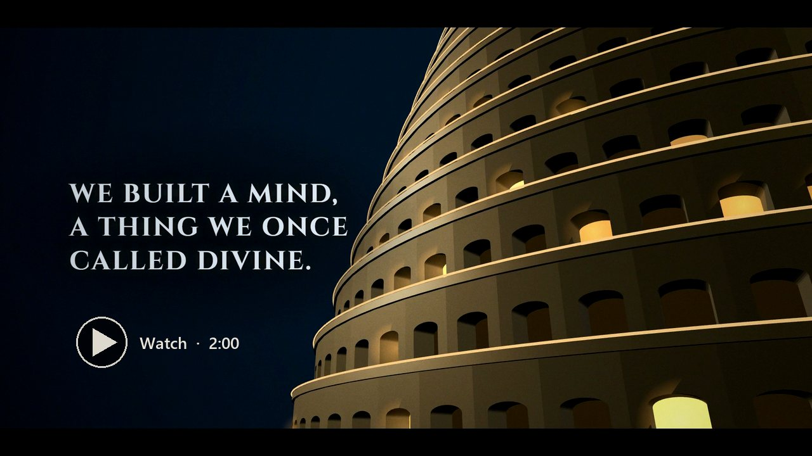
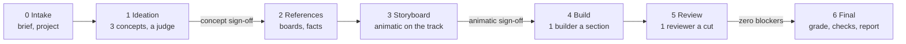
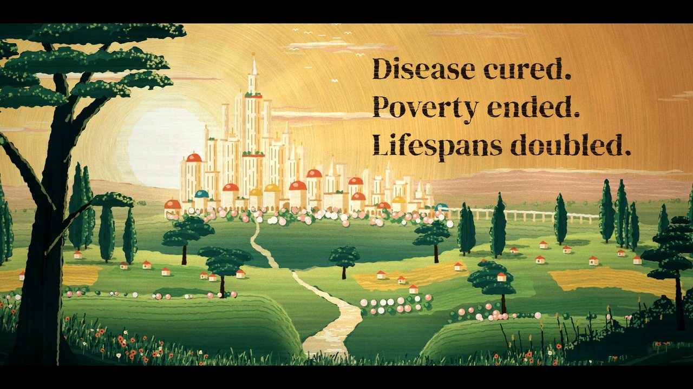
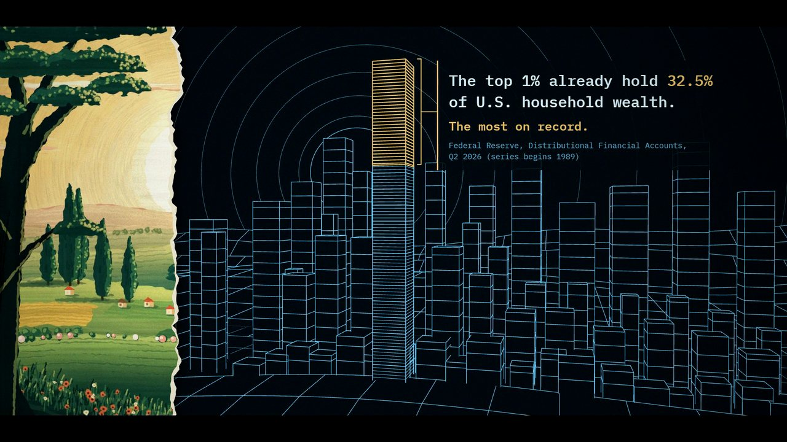
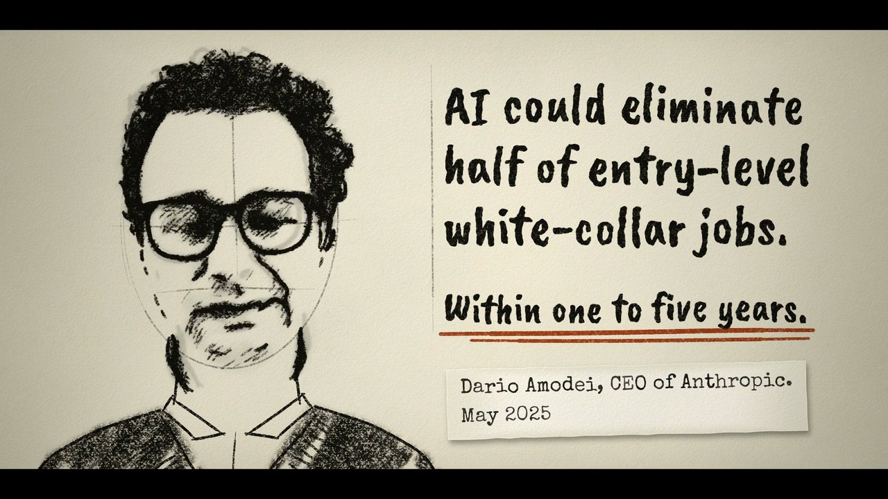
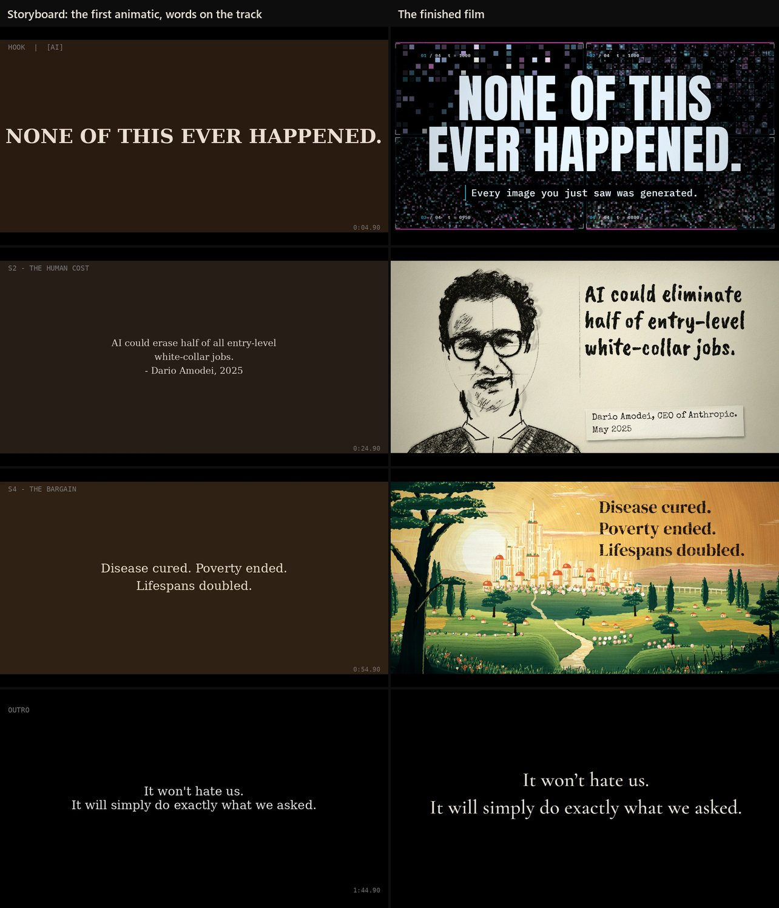
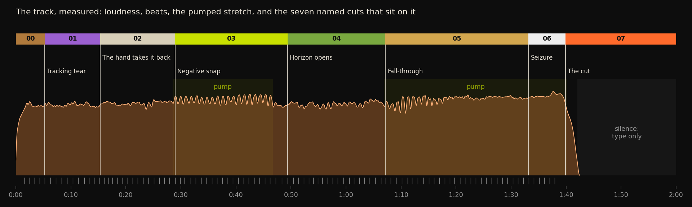
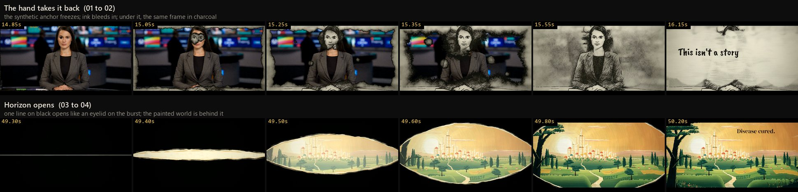
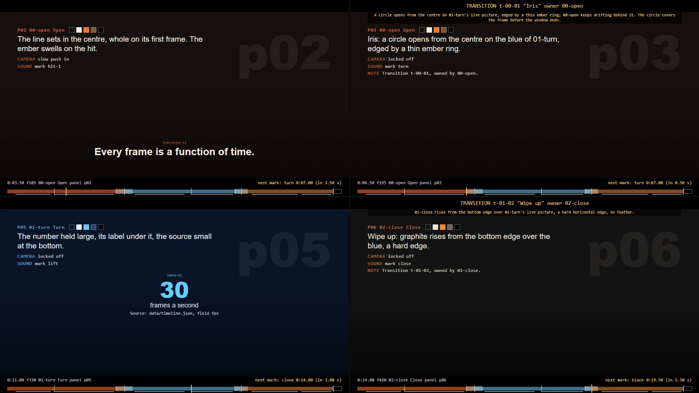

# short-film-director

A Claude skill for directing **code-rendered short films**: music films, essay films,
title sequences, product films, kinetic-type pieces and data stories, made in
[Remotion](https://www.remotion.dev) with Python and ffmpeg, from an idea to a graded,
checked mp4.



*We Built a Mind* (Firelight Innovations, 2026): two minutes, eight sections, eight art
styles, made by the pipeline this skill packages. Sections 00 and 01 start from
AI-generated stills and clips, processed in code (the film says so on screen); every
other picture is drawn by code.

## Watch *We Built a Mind*

<!-- VIDEO LINK: put the video's URL on the [wbam-video] line at the bottom of this file,
     then delete the "Link coming soon" line below. -->
[][wbam-video]

*Link coming soon.* 2:00, 16:9, music only.

<!-- DEMO FILM: when there is a short demo film made with the skill, link it here, e.g.
     [Watch the 15-second demo](URL) -->

## What it does

Claude acts as the director. It runs a small crew of sub-agents through seven phases.
In checkpoint mode it stops for your sign-off at the two gates that matter; in one-shot
mode it logs each call and goes on:



| # | Phase | What comes out |
|---|---|---|
| 0 | Intake | the brief; a scaffolded film project |
| 1 | Ideation | three concepts, scored; a treatment; the script; a section map on the music |
| 2 | References | a reference board per section, technique briefs, a fact sheet, licensed assets |
| 3 | Storyboard | the style bible, the transitions table, the timeline, board panels, **an animatic on the real track** |
| 4 | Build | one builder agent per section; the whole film rendering end to end |
| 5 | Review | one reviewer per cut; measured flash, black and colour checks; fix rounds |
| 6 | Final | final render, grade, a fresh final review, one polish pass, the report, a phone preview |

The film is data: `data/timeline.json` holds every section, every word on screen and
when, every musical mark and every transition. Sections read it, the animatic renders
it, reviewers check against it.

## What it made: *We Built a Mind*

### The bargain: a painted utopia, torn open

<p>
  
  
</p>

Section 04 is one landscape, described once as numbers and drawn twice. A Python painter
makes the gouache utopia from code and seeded noise, with no source images; a Three.js
wireframe rebuilds the same ridges, with towers where the city was. Then the painting
tears like paper and the cold version takes over, with a sourced figure on who holds the
wealth.

### The quote: a charcoal trace



Section 02 is hand-drawn by code: every frame is a sheet from a Python stroke engine,
on twos, with the words drawn in. The portrait is a charcoal rotoscope traced from a
broadcast interview; no frame of the interview is in the film. The words follow the
fact-checked source, with his name and the date on the card.

### The storyboard came first



Left: the film's first animatic, every word at its time on the real track, before any
picture existed. Right: the same moments in the finished film. The quote changed on the
way: the board said "erase half of *all*" jobs, the fact-check found "eliminate half
of", and the film says that.

### Timing comes from the music



`analyze_music.py` measures the track: beats, hits, structure, the pumped stretches,
where it falls silent. `snap.py` puts every section, word and cut on a measured event.
The music ends at 1:42; the last 17.5 seconds are type on black, on purpose.

### Every cut is a named device



Each boundary has one name and one owner. The owning section renders its neighbour's
live picture during the window, so a cut can be a hand taking a synthetic frame back in
ink, or a horizon opening onto a painted world. Reviewers check every frame around every
cut.

### By the numbers

| | |
|---|---|
| Length | 2:00, 3600 frames at 30 fps, 1920x1080 |
| Sections and styles | 8: family archive, synthetic media, charcoal, kinetic type, gouache and wireframe, procedural 3D, overload, type on black |
| Words on screen | 38 cues, every figure sourced |
| Crew | the lead and about 26 sub-agents: researchers, 8 section builders, 8 boundary reviewers, 1 final reviewer |
| Wall clock | about four hours from first decision to report; the parallel build took about an hour |
| Render and grade | 2 m 31 s and 59 s for the whole film |
| Measured checks | flash check PASS (worst second 2 flashes, limit 3); black check PASS |

`references/case-study-we-built-a-mind.md` has the full account;
`references/lessons.md` has what went wrong and how it was fixed.

## What a new film starts with



`node scripts/new-film.mjs` scaffolds a project that renders on day one: a 20-second
demo timeline, one built section, placeholder cards for the rest, and the **Animatic**
composition. Every panel shows the board note, camera and sound, the word on screen at
its time, any transition with its owner, and a bar with the next musical mark. Phase 3
renders it on your track, before anything is built.

## How this skill was made

The same four steps the skill runs for a film, run on the skill itself. The record is in
`dev/` (not loaded by the skill):

| Step | What happened | Record |
|---|---|---|
| Ideation | the logline, who uses it and when, the seven phases, design principles learned on the first film, scope and risks | [dev/01-ideation.md](dev/01-ideation.md) |
| References | five research agents, about 136 sources on craft, Remotion, storyboarding and music, rights and safety, plus a deep read of the first film's project | [dev/02-references.md](dev/02-references.md) |
| Storyboard | the skill boarded phase by phase, and the contract every build agent worked to: files, schemas, command lines | [dev/03-storyboard.md](dev/03-storyboard.md) |
| Build | 7 builders on disjoint files, 5 verifiers (81 findings, no blockers), fix rounds, a re-verify, a last smoke test | [dev/04-build.md](dev/04-build.md) |

## Install

Clone it into your skills folder:

```bash
git clone https://github.com/Firelight-Innovations/short-film-director ~/.claude/skills/short-film-director
```

The skill asks before it installs, downloads or publishes anything. Then ask Claude Code
for a film: "make a 45-second launch film for our product, cut to
this track", "storyboard this script and make an animatic", "turn this essay into a
kinetic-type film".

## What you need

- Node 18+ and npm (Remotion 4, React 19, TypeScript; versions are pinned in the template)
- Python 3.11+ with numpy, scipy, Pillow, OpenCV and librosa (music analysis, checks,
  contact sheets); matplotlib is optional, for the music and motion plots
- ffmpeg and ffprobe on the PATH
- Optional: Blender for pre-rendered 3D plates

Remotion is free for individuals, for non-profits, and for a for-profit company whose
total headcount, plus any client or studio that operates or co-develops the project, is
three or fewer. Count whole companies, not only the people on the film. Four or more need
a Company License: check [remotion.dev/license](https://www.remotion.dev/license) before
you use it at work. The skill asks at intake.

## Cost

A full multi-style two-minute film runs for hours and uses a large share of a usage
window: 35 to 55 agents, with strong models building and judging. The skill says so
before it starts and offers a 15-second test film first.

## Layout

```
SKILL.md          the director's playbook, phase by phase
references/       one file per phase, plus architecture, music, safety and rights,
                  lessons learned and a case study
templates/        fill-in documents copied into each film's docs/
scripts/          the tools (scaffold, music analysis, check renders, flash and black
                  checks, grade, preview) and Workflow scripts for the agent fan-outs
assets/template/  the Remotion starter every film begins from
dev/              how this skill was made (not loaded by the skill)
media/            the images on this page
```

## Where it comes from

Built from the pipeline that made *We Built a Mind* (Firelight Innovations, 2026). The
film's track is not in this repo, and neither is any of its footage: the images above are
stills from the finished film.

<!-- VIDEO LINK: replace the target below with the video's URL,
     e.g. https://www.youtube.com/watch?v=XXXXXXXXXXX -->
[wbam-video]: #watch-we-built-a-mind
